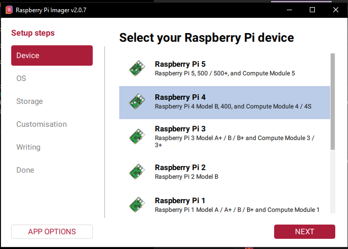

# Raspberry Pi 4 Model B


While this setup works, there is other solutions that are less setup involved and less vodoo shit.

I will post more ways to spoof ARP in the near future.


#### Download link ([https://www.raspberrypi.com/software/](https://www.raspberrypi.com/software/))

Flash your MicroSD card using raspberrypi OS, I am using Pi 4 Model B, arm64 version.

### How to flash the MicroSD

<figure><figcaption></figcaption></figure>

<figure><figcaption></figcaption></figure>

<figure><figcaption></figcaption></figure>

<figure><figcaption></figcaption></figure>

<figure><figcaption></figcaption></figure>

<figure><figcaption></figcaption></figure>

### If you are using WiFi ⇒ RJ45(Ethernet Adapter)

<figure><figcaption></figcaption></figure>

If not just leave empty, your SSID must be your routers WiFi Name and you must make sure to press "SECURE NETWORK" to see the password fields.

<figure><figcaption></figcaption></figure>

<figure><figcaption></figcaption></figure>

<figure><figcaption></figcaption></figure>

***

#### Choose Your Upstream Setup

The setup script below supports two ways of getting internet to the Raspberry Pi. Pick whichever suits you best when prompted:

* **Option 1 — WiFi (`wlan0`):** Easiest setup, no extra hardware needed.
* **Option 2 — USB Ethernet Adapter (`eth1`):** Full wired speeds and lower latency for gaming. _(Keeps `wlan0` connected as a backup for SSH if configured.)_

```
                 Internet
                    │
               Main Router
               192.168.0.1
                    │
         wlan0 (Option 1) OR eth1 (Option 2)
               192.168.0.x
                    │
             Raspberry Pi 4
                    │
                  eth0 (Random MAC on every reboot)
               10.0.0.1/24
                    │
                  RJ45
                    │
                Gaming PC
               10.0.0.2–254
```


If you use a USB Ethernet adapter, Linux may name it `eth1`, `enx...`, or similar. The script will display all detected interfaces at the start so you can enter the exact name.


***

#### Connect to the Raspberry Pi

* Connect to the Device using (Putty) SSH
* If your Raspberry Pi is connected to a router you can login to the admin panel and find the IPv4 its using in the device list: (image preview below)

<figure><figcaption></figcaption></figure>

* Download Putty ([https://the.earth.li/\~sgtatham/putty/latest/w64/putty.exe](https://the.earth.li/~sgtatham/putty/latest/w64/putty.exe))
* Install Putty, is not rocket science.
* In putty connect to your raspberry pi

***

### Automated Setup Script


**SSH Lockout Warning:** Once the script finishes, the firewall blocks **all** direct traffic from your PC (`eth0`) to the Pi (`10.0.0.1`)—including PuTTY/SSH and ping—except DHCP (UDP 67). It also blocks your PC from reaching your main router and other devices on your home LAN (`192.168.0.0/24`).


To manage the Pi afterward, SSH into the Pi's main network IP (`192.168.0.x`) from another device on your home router.

#### 1. Update the Pi

```bash
sudo -i
apt update && apt upgrade -y
```

#### 2. Create the Setup Script

Create the file:

```bash
nano setup-pi-router.sh
```

Copy and paste the entire script below into `nano`:

```bash
#!/usr/bin/env bash
set -euo pipefail

# ==============================================================================
# Raspberry Pi 4 Router Automated Setup
# - Disables systemd-networkd / Netplan conflicts so NetworkManager has control
# - Configures eth0 as 10.0.0.1/24 LAN with a random MAC on every reboot
# - Supports Option 1 (WiFi / wlan0) or Option 2 (USB Ethernet / eth1)
# - Sets up dnsmasq DHCP (10.0.0.2 - 10.0.0.254) with Cloudflare DNS (1.1.1.1)
# - Locks down nftables: NAT + isolates home LAN + drops all PC->Pi ports except
#   DHCP + hides Pi (10.0.0.1) and main router (192.168.0.1) from WinMTR/tracert
# ==============================================================================

if [[ $EUID -ne 0 ]]; then
  echo "[ERROR] Please run this script with sudo: sudo bash $0"
  exit 1
fi

ask() {
  local prompt="$1"
  local default="$2"
  local reply
  read -rp "$prompt [$default]: " reply < /dev/tty || true
  echo "${reply:-$default}"
}

echo "=============================================="
echo "     Raspberry Pi Router Automated Setup      "
echo "=============================================="
echo ""
echo "Detected network interfaces:"
ip -br link | awk '{print "  - " $1 " (" $2 ")  MAC: " $3}'
echo ""

# 1. Choose Upstream (WAN)
echo "Select your upstream internet interface (WAN):"
echo "  1) WiFi (wlan0) - Easiest, no extra hardware"
echo "  2) USB Ethernet Adapter (eth1) - Full wired speed & lower latency"
WAN_CHOICE=$(ask "Enter 1 or 2" "2")

if [[ "$WAN_CHOICE" == "1" ]]; then
  WAN_TYPE="wifi"
  WAN_IF=$(ask "Enter your WiFi interface name" "wlan0")
else
  WAN_TYPE="ethernet"
  WAN_IF=$(ask "Enter your USB Ethernet interface name" "eth1")
fi

# 2. Confirm Downstream (LAN)
LAN_IF=$(ask "Enter your PC-facing Ethernet interface (LAN)" "eth0")

if [[ "$WAN_IF" == "$LAN_IF" ]]; then
  echo "[ERROR] WAN and LAN interfaces cannot be the same ($WAN_IF)."
  exit 1
fi

# 3. Auto-detect main router subnet to isolate
DETECTED_SUBNET=$(ip -4 route show dev "$WAN_IF" 2>/dev/null | awk '/proto kernel/ {print $1; exit}' || true)
if [[ -z "$DETECTED_SUBNET" ]]; then
  DETECTED_SUBNET=$(ip -4 route | awk '/proto kernel/ && !/10\.0\.0\.0\/24/ {print $1; exit}' || true)
fi
DETECTED_SUBNET="${DETECTED_SUBNET:-192.168.0.0/24}"
HOME_SUBNET=$(ask "Main router subnet to block from your PC" "$DETECTED_SUBNET")

# 4. Optional Static IP for USB Ethernet
WAN_IP_MODE="dhcp"
WAN_STATIC_IP=""
WAN_GATEWAY=""
if [[ "$WAN_TYPE" == "ethernet" ]]; then
  echo ""
  echo "How should $WAN_IF get its IP from your main router?"
  echo "  1) DHCP (Recommended / Easiest)"
  echo "  2) Static IP (e.g. 192.168.0.119/24)"
  IP_CHOICE=$(ask "Enter 1 or 2" "1")
  if [[ "$IP_CHOICE" == "2" ]]; then
    WAN_IP_MODE="static"
    DEFAULT_GW=$(ip route | awk '/default/ {print $3; exit}' || true)
    DEFAULT_GW="${DEFAULT_GW:-192.168.0.1}"
    WAN_STATIC_IP=$(ask "Static IP with prefix for $WAN_IF (e.g. 192.168.0.119/24)" "192.168.0.119/24")
    WAN_GATEWAY=$(ask "Main router gateway IP" "$DEFAULT_GW")
  fi
fi

# 5. Summary & Confirmation
echo ""
echo "================ CONFIGURATION SUMMARY ================"
echo "  WAN (Internet) : $WAN_IF ($WAN_TYPE / $WAN_IP_MODE)"
if [[ "$WAN_IP_MODE" == "static" ]]; then
  echo "  WAN Static IP  : $WAN_STATIC_IP (gw $WAN_GATEWAY)"
fi
echo "  LAN (PC)       : $LAN_IF -> 10.0.0.1/24 (Random MAC every reboot)"
echo "  DHCP Range     : 10.0.0.2 - 10.0.0.254 (DNS: 1.1.1.1, 1.0.0.1)"
echo "  Blocked Subnet : $HOME_SUBNET (isolated + hidden from WinMTR/tracert)"
echo "  Pi Firewall    : Drops all PC -> Pi ports except DHCP (UDP 67) & hides 10.0.0.1 hop"
echo "======================================================="
echo ""
echo "[WARNING] After this script finishes, your PC on $LAN_IF will NOT be able"
echo "          to SSH/PuTTY into 10.0.0.1. Manage the Pi via its $HOME_SUBNET IP."
CONFIRM=$(ask "Proceed with installation? (y/n)" "y")
if [[ ! "$CONFIRM" =~ ^[Yy]$ ]]; then
  echo "Aborted."
  exit 0
fi

# 6. Install required packages
echo ""
echo "[1/6] Installing nftables and dnsmasq..."
apt-get update -qq
DEBIAN_FRONTEND=noninteractive apt-get install -y -qq nftables dnsmasq

# 7. Disable systemd-networkd & remove conflicting Netplan/networkd configs
echo "[2/6] Cleaning up systemd-networkd/Netplan conflicts & configuring NetworkManager..."
systemctl disable --now systemd-networkd systemd-networkd.socket 2>/dev/null || true
if ls /etc/systemd/network/* >/dev/null 2>&1; then
  mkdir -p /root/networkd-backup
  mv /etc/systemd/network/* /root/networkd-backup/ 2>/dev/null || true
  echo "  -> Moved old /etc/systemd/network/ files to /root/networkd-backup/"
fi
systemctl enable --now NetworkManager >/dev/null 2>&1 || true

rm -f /etc/netplan/01-router.yaml
nmcli connection delete netplan-eth0 netplan-eth1 2>/dev/null || true

mkdir -p /etc/NetworkManager/conf.d
cat <<'EOF' > /etc/NetworkManager/conf.d/99-random-mac.conf
[connection]
ethernet.cloned-mac-address=random
EOF

# Configure LAN (eth0 -> 10.0.0.1/24, inherits random MAC)
nmcli connection delete eth0-lan 2>/dev/null || true
nmcli connection add type ethernet con-name eth0-lan ifname "$LAN_IF" \
  ipv4.method manual ipv4.addresses 10.0.0.1/24 \
  ipv6.method disabled connection.autoconnect yes >/dev/null

# Configure WAN
ACTIVE_WIFI=$(nmcli -t -f NAME,TYPE connection show --active | awk -F: '$2=="802-11-wireless"{print $1; exit}' || true)

if [[ "$WAN_TYPE" == "wifi" ]]; then
  if [[ -n "$ACTIVE_WIFI" ]]; then
    nmcli connection modify "$ACTIVE_WIFI" \
      802-11-wireless.cloned-mac-address permanent \
      802-11-wireless.powersave 2
    echo "  -> Configured WiFi profile '$ACTIVE_WIFI' (permanent MAC, power-save off)."
  else
    echo "  [WARN] No active WiFi connection detected. Make sure WiFi is connected in NetworkManager."
  fi
else
  nmcli connection delete eth1-wan 2>/dev/null || true
  if [[ "$WAN_IP_MODE" == "static" ]]; then
    nmcli connection add type ethernet con-name eth1-wan ifname "$WAN_IF" \
      ipv4.method manual ipv4.addresses "$WAN_STATIC_IP" \
      ipv4.gateway "$WAN_GATEWAY" ipv4.dns "1.1.1.1 1.0.0.1" \
      ipv4.route-metric 100 ethernet.cloned-mac-address permanent \
      ipv6.method disabled connection.autoconnect yes >/dev/null
  else
    nmcli connection add type ethernet con-name eth1-wan ifname "$WAN_IF" \
      ipv4.method auto ipv4.route-metric 100 \
      ethernet.cloned-mac-address permanent \
      ipv6.method disabled connection.autoconnect yes >/dev/null
  fi

  # Keep WiFi as lower-priority backup SSH if present
  if [[ -n "$ACTIVE_WIFI" ]]; then
    nmcli connection modify "$ACTIVE_WIFI" \
      ipv4.route-metric 600 \
      802-11-wireless.cloned-mac-address permanent \
      802-11-wireless.powersave 2
    echo "  -> Kept WiFi '$ACTIVE_WIFI' as backup SSH (metric 600)."
  fi
fi

# 8. Enable IPv4 Forwarding
echo "[3/6] Enabling IPv4 forwarding..."
echo "net.ipv4.ip_forward=1" > /etc/sysctl.d/99-router.conf
sysctl --system >/dev/null

# 9. Configure dnsmasq
echo "[4/6] Configuring dnsmasq DHCP server (10.0.0.2 - 10.0.0.254)..."
cat <<EOF > /etc/dnsmasq.d/router.conf
interface=$LAN_IF

dhcp-range=10.0.0.2,10.0.0.254,255.255.255.0,12h

dhcp-option=3,10.0.0.1
dhcp-option=6,1.1.1.1,1.0.0.1
EOF
systemctl enable dnsmasq >/dev/null 2>&1

# 10. Configure nftables
echo "[5/6] Configuring nftables NAT and isolation firewall..."
cat <<EOF > /etc/nftables.conf
#!/usr/sbin/nft -f

flush ruleset

define WAN = "$WAN_IF"
define LAN = "$LAN_IF"
define HOME_NET = $HOME_SUBNET

table ip nat {
    chain postrouting {
        type nat hook postrouting priority 100;
        oifname \$WAN masquerade
    }
}

table ip filter {
    chain input {
        type filter hook input priority 0;
        policy accept;

        # Allow only DHCP from the PC so it can get a 10.0.0.x IP
        iifname \$LAN udp dport 67 accept

        # Drop all other direct traffic from the PC to the Pi (SSH, ping, all ports)
        iifname \$LAN drop
    }

    chain output {
        type filter hook output priority 0;
        policy accept;

        # Hide 10.0.0.1 from WinMTR / tracert
        oifname \$LAN icmp type { time-exceeded, destination-unreachable } drop
    }

    chain forward {
        type filter hook forward priority 0;
        policy drop;

        # Block PC from reaching the main router and other devices on the home LAN
        iifname \$LAN ip daddr \$HOME_NET drop

        # Hide main router and home LAN from WinMTR / tracert
        iifname \$WAN oifname \$LAN ip saddr \$HOME_NET drop

        # Allow normal internet forwarding between LAN and WAN
        iifname \$LAN oifname \$WAN accept
        iifname \$WAN oifname \$LAN ct state related,established accept
    }
}
EOF

nft -c -f /etc/nftables.conf
systemctl enable nftables >/dev/null 2>&1

# 11. Apply live services
echo "[6/6] Applying network profiles and starting services..."
nmcli general reload || true
nmcli connection up eth0-lan >/dev/null 2>&1 || true
if [[ "$WAN_TYPE" == "ethernet" ]]; then
  nmcli connection up eth1-wan >/dev/null 2>&1 || true
fi
systemctl restart dnsmasq
systemctl restart nftables

echo ""
echo "=============================================="
echo "              SETUP COMPLETE!                 "
echo "=============================================="
echo "Current interfaces:"
ip -br addr
echo ""
echo "A reboot is recommended so $LAN_IF picks up a fresh random MAC cleanly."
DO_REBOOT=$(ask "Reboot now? (y/n)" "y")
if [[ "$DO_REBOOT" =~ ^[Yy]$ ]]; then
  echo "Rebooting..."
  reboot
fi
```

Save (`Ctrl+O`, `Enter`) and exit (`Ctrl+X`).

#### 3. Run the Script

```bash
chmod +x setup-pi-router.sh
./setup-pi-router.sh
```

Follow the on-screen prompts and choose **y** to reboot at the end.

***

### Final Verification (On Your Windows PC)

After the Raspberry Pi finishes rebooting, plug your PC into the Pi's built-in Ethernet port (`eth0`).

Open Command Prompt on your **Windows PC** and run:

```cmd
ipconfig /release
ipconfig /renew
ipconfig
```

Your PC should receive:

* **IPv4 Address:** `10.0.0.2` – `10.0.0.254`
* **Subnet Mask:** `255.255.255.0`
* **Default Gateway:** `10.0.0.1`

Test connectivity and firewall isolation from your PC:

```cmd
ping 1.1.1.1
ping 10.0.0.1
ping 192.168.0.1
tracert -d 1.1.1.1
arp -a
```

Expected results:

* `ping 1.1.1.1` → **Replies** (0% packet loss, internet works)
* `ping 10.0.0.1` → **Times out** (Pi is hidden/locked down from PC)
* `ping 192.168.0.1` → **Times out** (Main router & home LAN are isolated from PC)
* `tracert -d 1.1.1.1` (or **WinMTR**) → Hops 1 and 2 show `* * * Request timed out` / `No response from host` (both `10.0.0.1` and `192.168.0.1` are hidden), while Hop 3 onward and `1.1.1.1` respond normally
* `arp -a` → Shows `10.0.0.1` with a **randomized MAC address**

<figure><figcaption></figcaption></figure>

***

### If You Have Issues

If the PC cannot access the Internet, SSH into the Raspberry Pi using its `192.168.0.x` IP from another device and check:

```bash
ip -br addr
ip route
sysctl net.ipv4.ip_forward
nft list ruleset
systemctl status dnsmasq
```

Test upstream internet directly from your chosen WAN interface:

```bash
# For Option 2 (USB Ethernet):
ping -I eth1 -c 3 192.168.0.1
ping -I eth1 -c 3 1.1.1.1

# For Option 1 (WiFi):
ping -I wlan0 -c 3 192.168.0.1
ping -I wlan0 -c 3 1.1.1.1
```


Many USB Ethernet adapters silently drop incoming packets if their MAC address is randomized. The script locks `eth1` to its `permanent` MAC automatically—your PC **never** sees `eth1`'s MAC address anyway, only `eth0`'s randomized MAC.


**Advanced troubleshooting**

If packet handling appears to be failing under load, you can temporarily test with hardware/software offloading disabled:

```bash
sudo ethtool -K eth0 gro off gso off tso off
sudo ethtool -K eth1 gro off gso off tso off
```

**Do not treat this as a default configuration.** Restore normal settings with:

```bash
sudo ethtool -K eth0 gro on gso on tso on
sudo ethtool -K eth1 gro on gso on tso on
```

***

#### Result

Your final setup provides:

* **Option 1 (`wlan0`) or Option 2 (`eth1` USB Ethernet)** → `eth0` routing
* IPv4 forwarding + `nftables` NAT
* Strict firewall: blocks all PC-to-Pi ports (except DHCP UDP 67) and isolates your home LAN (`192.168.0.0/24`)
* Full `10.0.0.1/24` LAN subnet (`10.0.0.2` – `10.0.0.254`) via `dnsmasq` with Cloudflare DNS (`1.1.1.1`)
* Automatic randomized MAC address on `eth0` every reboot
* Pure NetworkManager configuration with `systemd-networkd` and Netplan conflicts automatically removed
